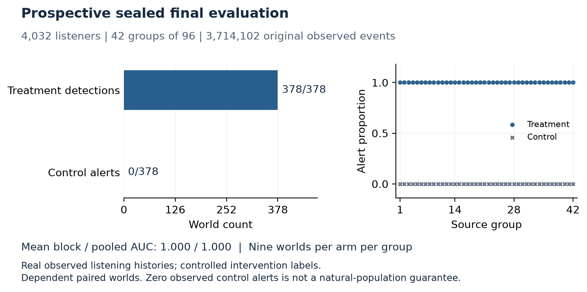
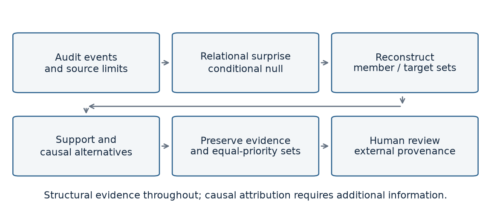
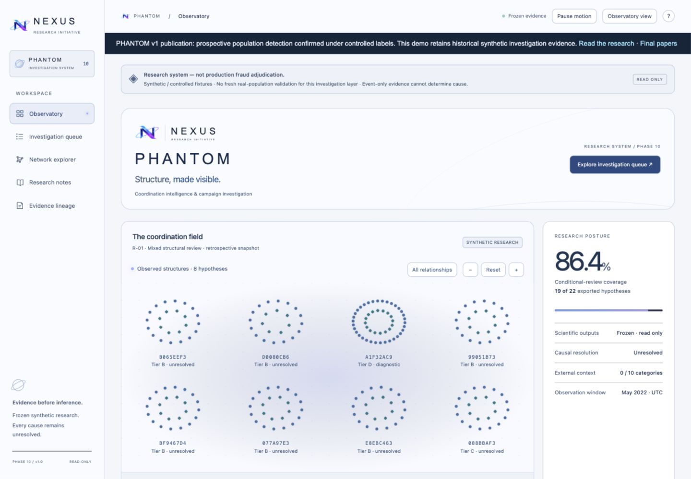

# NEXUS / PHANTOM


**Benchmark Validity and Causal Limits in Coordinated Listening**  
Nischit Girish Kumar  
NEXUS Research Initiative — Independent Research  
Independent Technical Report · October 2026

PHANTOM studies when listening-event evidence supports a claim about coordination and when its interpretation fails. It audits benchmark shortcuts, detects conditional relational surprise, reconstructs bounded campaign structure, and preserves unresolved causes for investigation.

This is a prepared local release candidate. It has not been published, submitted or indexed. The report is independent research and is not peer reviewed. Public release requires the author's explicit final authorization.

## What to remember

A valid controlled benchmark can establish structural detection without identifying why people acted together. PHANTOM separates **benchmark validity**, **structural transfer**, and **causal attribution**. The record includes rejected high-scoring designs and hard-negative failures, not just the accepted final score.

## Prospective final result

| Population and task | Confirmed result | Scope |
|---|---|---|
| September 1–28, 2026 UTC; 4,032 listeners in 42 groups; 3,714,102 observed events; 378 matched pairs | Mean block and pooled AUC 1.000; 378/378 treatment alerts; 0/378 control alerts | Real histories with controlled intervention labels. Dependent worlds. No verified fraud labels or natural-population false-positive estimate. |

The system and pre-final manuscript were frozen before final materialization. A pre-access namespace amendment and superseding execution lock remain disclosed. Planned independent replay covered all 756 worlds. The original verifier **failed during receipt serialization**; a separate post-final forensic verifier **confirmed immutable outputs** and all 18 scientific gates without rerunning or modifying the scientific evaluation. This is process/implementation independence, not institutional validation.



## Architecture and method



1. Audit source sessions, duplicates and input support.
2. Construct matched worlds preserving declared per-actor item/time marginals and duplicate invariants.
3. Compare relational coactivity against a local within-actor assignment null.
4. Reconstruct bounded member/target objects with duplicate-invariant presence and fixed candidate pooling.
5. Retain support limits, alternative causes and complete equal-priority sets for review.

For unique presences `(user, item, minute)`, the population statistic counts ordered cross-actor item coincidences divided by ordered cross-actor opportunities. With local null median `m` and scale `s = 1.4826 × MAD`, robust excess is `(C − m) / s`; the frozen alert threshold is 3. Zero-scale conventions and the exact recurring-schedule selector are specified in the paper. This is not a Gaussian tail or intent probability.

The graph method is separate: fixed selected-catalog candidates, 60/300-bin consensus, 511 constrained draws and a per-draw maximum comparison. Its historical two-block holdout achieved member/target F1 approximately 0.9167. The prospective final validates the population detector, not the complete investigation pipeline.

## Failures that bound the claim

Origin/neutral/catalog shortcuts and duplicate mismatch invalidated early benchmarks. Raw ranking could be perfect while 22/180 controls alerted. Behavioral vetoes degraded useful reconstruction, and non-veto augmentation added no tested ranking gain. Popularity/release shocks each alerted in all 12 moderate worlds; shifted overlap produced F1 0.3636 and full control burden. These are historical development stress results. The broad operating requirement failed.

Two hidden accounts can yield the same permitted event array. With cause-independent randomness, any event-only method then has the same output distribution under both. This applies established observational-equivalence reasoning to a concrete listening construction. External provenance may help; a stronger score on the identical array cannot supply it.

See the [public release notice](PUBLIC_RELEASE_NOTICE.md) and [build-component inventory](docs/PHANTOM_PUBLIC_SBOM.csv) for scope, dependencies and local preference storage.

## Run the public materials

Run reproduction commands in a disposable working copy: builders intentionally replace generated figures, PDFs and metadata inside that copy.

Python 3 is sufficient for the teaching example and tests:

```sh
python3 demo/toy_permutation.py
python3 -m unittest discover -s tests -v
```

Every toy identifier is invented. It illustrates shuffling and duplicate invariance; it is **not a reproduction of the frozen detector or final experiment**.

To rebuild vector figures from released aggregates:

```sh
python3 -m venv .venv
. .venv/bin/activate
python3 -m pip install -r requirements.txt
python3 scripts/render_figures.py
python3 scripts/render_final_figure.py
```

Manuscripts require Tectonic and an available TeX bundle. First obtain the external acmart 2.20 class and follow the [template dependency setup](papers/PHANTOM_Conference_Manuscript_FINAL_v1/TEMPLATE_PROVENANCE.md), then run `python3 scripts/build_papers.py`. `scripts/render_support_pdfs.py` builds the supplement and one-page brief. Exact byte identity of rebuilt PDFs is not promised across font/compiler versions. The delivered hashes identify the reviewed files.

To view the portfolio and unchanged synthetic evidence locally:

```sh
python3 -m http.server 8000 --bind 127.0.0.1 --directory site
```

Open `http://127.0.0.1:8000/research/phantom/` in a browser. The demo at `/research/phantom/demo/` displays five complete historical synthetic runs; it has no final protected truth, scientific recomputation or enforcement action. The public presentation incorporates the author-selected NEXUS identity; its provenance is documented.



## Source-dependent reproduction

Obtain Deezer and ListenBrainz data independently from their official sources. Follow [Source reproduction instructions](docs/SOURCE_REPRODUCTION.md) for citations, snapshot identifiers, checksums, date windows, schemas, eligibility and preprocessing. Do not substitute a newer snapshot for the reported one or mirror raw datasets in this repository. The guide distinguishes public-material reproduction from source preparation and exact experimental reproduction requiring separately cleared resources.

## Repository map

- `papers/`: final PDFs and editable sources; independent manuscripts.
- `figures/`, `tables/`: vector diagrams and frozen aggregates, with provenance.
- `references/`: verified bibliography and citation ledger.
- `demo/`, `tests/`: invented teaching example and bounded public-material checks.
- `site/`: portfolio and read-only historical synthetic dashboard.
- `docs/`: architecture, limitations, provenance, release boundaries and versioning.
- `screenshots/`: direct browser captures of the synthetic public presentation.

The full scientific core, raw histories, protected truth and internal orchestration logs are excluded. This is a deliberately curated publication package, not a full open reproduction of every historical experiment.

## Papers

- [Technical report](papers/PHANTOM_Technical_Report_FINAL_v1.pdf)
- [Conference manuscript](papers/PHANTOM_Conference_Manuscript_FINAL_v1.pdf)
- [Supplement](papers/PHANTOM_Supplementary_Appendix_FINAL_v1.pdf)
- [One-page research brief](papers/PHANTOM_Industry_Research_Brief_FINAL_v1.pdf)

## Limits and rights

The intervention and selector are narrow; ordinary-stream support coverage is unknown. Worlds share groups and constructed arms. The graph holdout is small, stress sets are consumed, matched published-method comparisons are absent, and analyst/deployment outcomes are unmeasured. No SOTA, verified fraud accuracy, causal probability, organizer identification or production-readiness claim is made.

See [rights and release matrix](docs/PHANTOM_RIGHTS_RELEASE_MATRIX.md). Author-created material is supplied with rights reserved pending an explicit reuse-license decision; this candidate must not be described as permissively licensed open source. Third-party components retain their notices. Code licensing does not settle data licensing. No raw Deezer or ListenBrainz histories or protected final records are included.

## Citation and authorship

Kumar, N. G. (2026). *PHANTOM: Benchmark Validity and Causal Limits in Coordinated Listening* (Final v1). NEXUS Research Initiative, Independent Technical Report. See [citation variants](CITATION.md) and `CITATION.cff`. No DOI or conference acceptance is claimed.

Nischit Girish Kumar is the sole human author. AI-assisted tools supported selected engineering tasks, with minor assistance in documentation and manuscript preparation. Nischit Girish Kumar directed the research, system architecture, experimental design, validation, and final technical decisions and assumes responsibility for the work. NEXUS Research Initiative denotes independent research, not institutional sponsorship.
